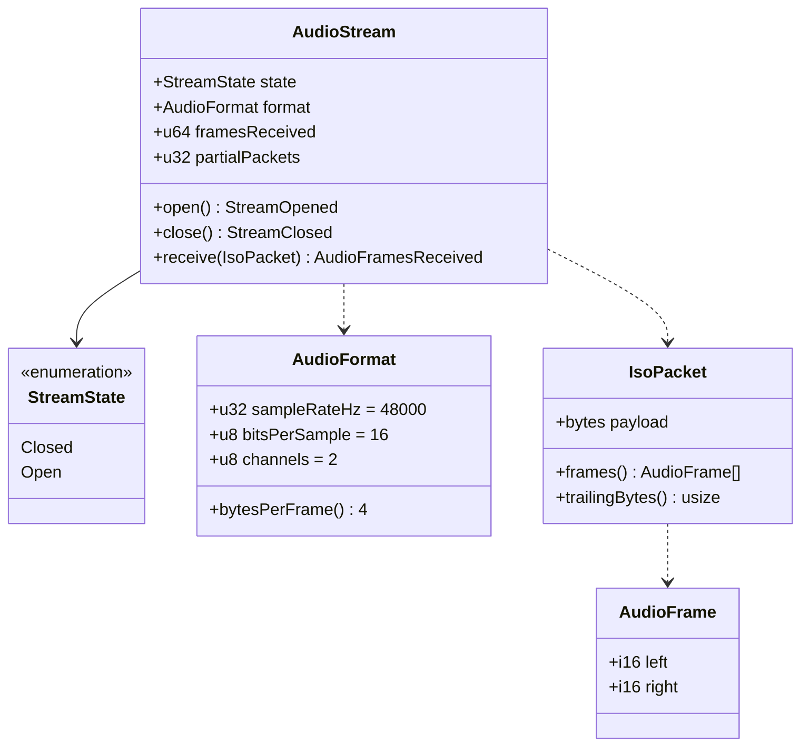
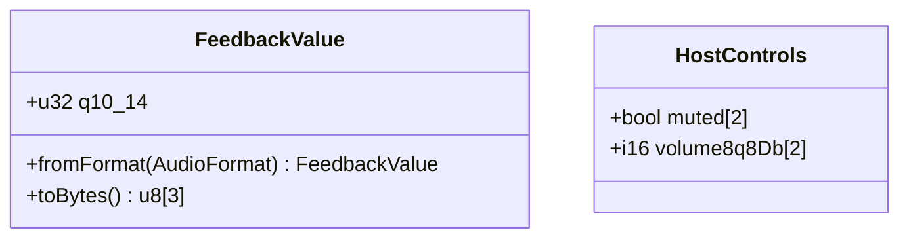

# audio-in — ドメインモデル

相手: ホストのオーディオ経路（[system-context.md](../../system-context.md)）。

## この文脈の言語

| 用語 | 意味 |
|---|---|
| 音声ストリーム | ホストが代替設定 1 を選んでから 0 に戻すまでの、アイソクロナス OUT の流れ |
| 代替設定 | USB Audio のストリーミングインタフェースの設定番号。0 = 閉、1 = 開 |
| 音声パケット | 1 ms ごとに届くアイソクロナス OUT のペイロード。通常 192 B（48 フレーム） |
| 端数バイト | 4 B の倍数に満たず、音声フレームにならないパケット末尾のバイト |
| フィードバック値 | デバイスが受け入れたいレートを 10.14 固定小数点（kHz 単位）でホストに伝える値 |
| ホスト制御値 | ホストが設定する音量とミュート。**記録するが適用しない**（[ADR-0003](../../ADR/0003-never-apply-host-volume-and-mute.md)） |

`capture-link` へ渡すのは **音声フレーム** だけである。
代替設定、パケット、フィードバックはこの文脈の外に出さない。

## 集約と値オブジェクト

### AudioStream 集約

- `receive` はパケットを先頭から 4 B ずつ音声フレームに切り出す。端数バイトは捨て、`partialPackets` を数える
- `Closed` の間に届いたパケットは受け取らない（USB 上は起こらないが、ドメインとしては拒否する）
- 音声フレームのサンプル値は、パケットのバイト列をリトルエンディアンでそのまま読んだ値である

### 値オブジェクト: FeedbackValue · HostControls

- フィードバック値は書式から決まる定数 48.0（`0x0C0000`）である。デバイスに DAC のクロックは無く、受けた量をそのまま流すため
- `HostControls` は `capture-link` の INFO で報告するために保持する。サンプルには一切作用しない

### ドメインイベント

| イベント | 内容 |
|---|---|
| `StreamOpened` | 代替設定 1 が選ばれた |
| `StreamClosed` | 代替設定 0 が選ばれた、または USB がリセットされた |
| `AudioFramesReceived` | 1 パケット分の音声フレーム列。`capture-link` が購読する |

## 対応する src

| モデル | src |
|---|---|
| `AudioStream`、`AudioFrame`、`AudioFormat`、`HostControls`、`FEEDBACK_48K`（`FeedbackValue`）。`IsoPacket` は `&[u8]` と `Frames` で表す | [capture-core/src/audio_in.rs](../../../capture-core/src/audio_in.rs)（`no_std`、ホストでテスト可能） |
| USB Audio の配線（embassy-usb `uac1::speaker`）: `audio_task`、`feedback_task`、`control_task` | [firmware/src/main.rs](../../../firmware/src/main.rs) |

## Review Notes

### 2026-11-26 第 1 回

ユーザーがモデルを承認した。提示した判断点は既定案で確定した。

- ホスト側の途切れ（パケットが来ない区間）の検出は今回の範囲に含めない。USB フレーム番号（SOF）は DATA に載せない
- 録音中の START は ERROR(AlreadyRecording) を返し、進行中のセッションは続ける
- INFO（CAP-4）は残す
- ADR-0003、ADR-0004 は Accepted
