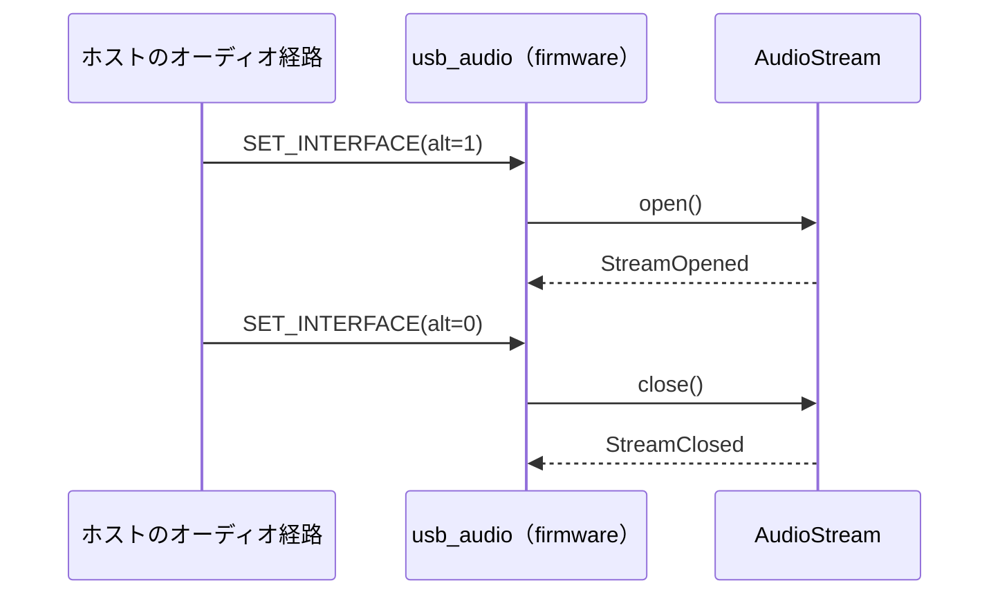
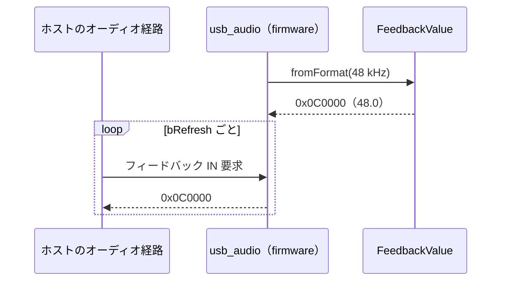

# audio-in — オブジェクトモデル

正本: [system-context.md](../../system-context.md)、[use-cases.md](../../use-cases.md)。

## この文脈が担うユースケース

| ID | ユースケース |
|---|---|
| AUD-1 | 音声ストリームを開く・閉じる |
| AUD-2 | 音声パケットを受け、音声フレームとして公開する |
| AUD-3 | 送出レートのフィードバックを返す |

## やりとり

### AUD-1 音声ストリームを開く・閉じる



### AUD-2 音声パケットを受け、音声フレームとして公開する

```mermaid
sequenceDiagram
  participant Engine as ホストのオーディオ経路
  participant USB as usb_audio（firmware）
  participant Stream as AudioStream
  participant Link as capture-link
  Engine->>USB: アイソクロナス OUT（192 B）
  USB->>Stream: receive(IsoPacket)
  Stream->>Stream: 4 B ずつ AudioFrame へ、端数は捨てて数える
  Stream-->>USB: AudioFramesReceived(48 frames)
  USB->>Link: accept(frames)
```

### AUD-3 送出レートのフィードバックを返す



## Review Notes

### 2026-11-26 第 1 回

ユーザーがモデルを承認した。提示した判断点は既定案で確定した。

- ホスト側の途切れ（パケットが来ない区間）の検出は今回の範囲に含めない。USB フレーム番号（SOF）は DATA に載せない
- 録音中の START は ERROR(AlreadyRecording) を返し、進行中のセッションは続ける
- INFO（CAP-4）は残す
- ADR-0003、ADR-0004 は Accepted
