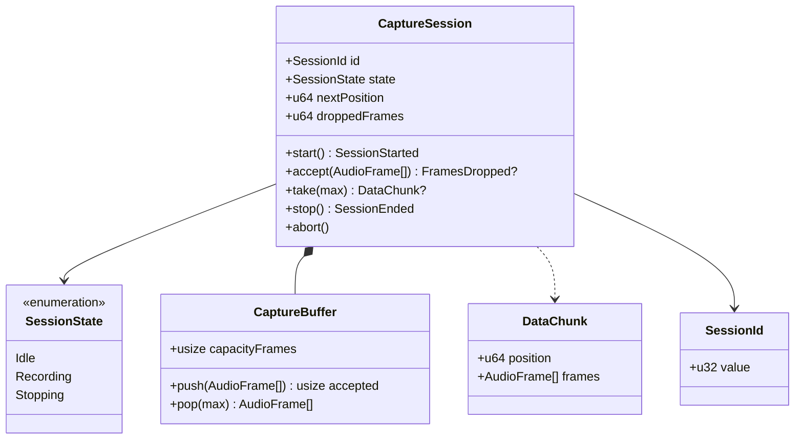
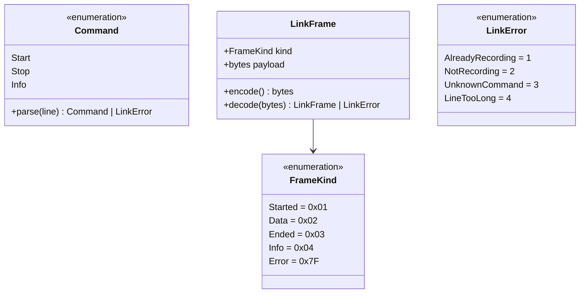

# capture-link — ドメインモデル

相手: テストハーネス（[system-context.md](../../system-context.md)）。
ワイヤ形式の決定: [ADR-0004](../../ADR/0004-frame-cdc-link-with-sync-and-crc.md)。

## この文脈の言語

| 用語 | 意味 |
|---|---|
| 録音セッション | START を受けてから STOP（または切断）までの範囲。`SessionId` で区別する |
| 位置 | セッション開始後に `audio-in` から受け取った音声フレームの通し番号（0 始まり）。欠落したフレームも番号を消費する |
| 欠落 | キャプチャバッファが満杯で、受け取った音声フレームを捨てたこと。位置の飛びとして現れる |
| キャプチャバッファ | 受け取った音声フレームを CDC で送るまで保持するリングバッファ |
| コマンド | ハーネスから届く ASCII の 1 行（`START` / `STOP` / `INFO`） |
| リンクフレーム | デバイスからハーネスへ送る、同期語と CRC 付きのバイナリの単位 |
| データチャンク | DATA リンクフレームの中身。先頭の位置と、連続する音声フレーム列 |

`audio-in` の語彙（代替設定、パケット）はこの文脈に現れない。
音声ストリームが閉じている間は、単に音声フレームが届かない。

## 集約と値オブジェクト

### CaptureSession 集約

- `Idle` で受け取った音声フレームは数えずに捨てる
- `Recording` で受け取ったフレームはバッファに入れる。入りきらない分は **新しい側を** 捨て、`droppedFrames` に足す。位置は捨てた分も進む
- `take` は連続する位置のフレームだけを 1 つのデータチャンクにする。欠落をまたがない
- `stop` は `Stopping` に移り、STOP 以前に受け取ったフレームをすべて送り終えてから `SessionEnded` を出して `Idle` に戻る
- `abort` は CDC の切断（DTR が下がる）と USB リセットで呼ばれ、何も送らず `Idle` に戻る
- `SessionId` はセッションごとに 1 ずつ増える。電源投入後の最初は 1

### LinkFrame と Command（値オブジェクト）

ワイヤ形式（詳細と理由は ADR-0004）:

| 部分 | 長さ | 内容 |
|---|---|---|
| 同期語 | 2 | `A5 5A` |
| 種別 | 1 | `FrameKind` |
| 長さ | 2 | ペイロード長（u16 LE） |
| ペイロード | n | 種別ごと（下表） |
| CRC | 2 | CRC-16/CCITT-FALSE（種別〜ペイロード、u16 LE） |

| 種別 | ペイロード |
|---|---|
| STARTED | `session_id` u32 |
| DATA | `position` u64、音声フレーム × 1〜256（各 4 B、L, R の i16 LE） |
| ENDED | `session_id` u32、`total_frames` u64、`dropped_frames` u64 |
| INFO | UTF-8 の `key=value\n` 行。キーは `version`、`format`（`48000/16/2`）、`state`（`idle` / `recording` / `stopping`）、`stream`（`open` / `closed`）、`session`、`position`、`dropped`、`volume_8q8`（`L,R`、1/256 dB 単位）、`mute`（`L,R`、0 / 1） |
| ERROR | `code` u8（`LinkError`） |

### ドメインイベント

| イベント | リンクフレーム |
|---|---|
| `SessionStarted` | STARTED |
| `FramesDropped` | なし（位置の飛びと ENDED の `dropped_frames` に現れる） |
| `SessionEnded` | ENDED |

## 対応する src

| モデル | src（予定） |
|---|---|
| `CaptureSession`, `CaptureBuffer`, `DataChunk`, `SessionId` | `capture-core/src/session.rs` |
| `LinkFrame`, `FrameKind`, `Command`, `LinkError`, CRC | `capture-core/src/link.rs` |
| CDC ACM の配線 | `firmware/src/cdc_link.rs` |
| ハーネス側のデコーダ | `host/e2e_audio/link.py` |

## Review Notes

### 2026-11-26 第 1 回

ユーザーがモデルを承認した。提示した判断点は既定案で確定した。

- ホスト側の途切れ（パケットが来ない区間）の検出は今回の範囲に含めない。USB フレーム番号（SOF）は DATA に載せない
- 録音中の START は ERROR(AlreadyRecording) を返し、進行中のセッションは続ける
- INFO（CAP-4）は残す
- ADR-0003、ADR-0004 は Accepted
