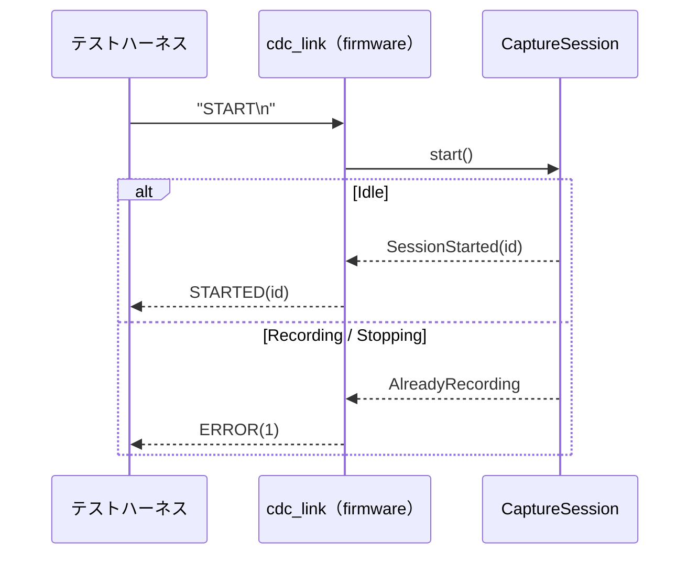
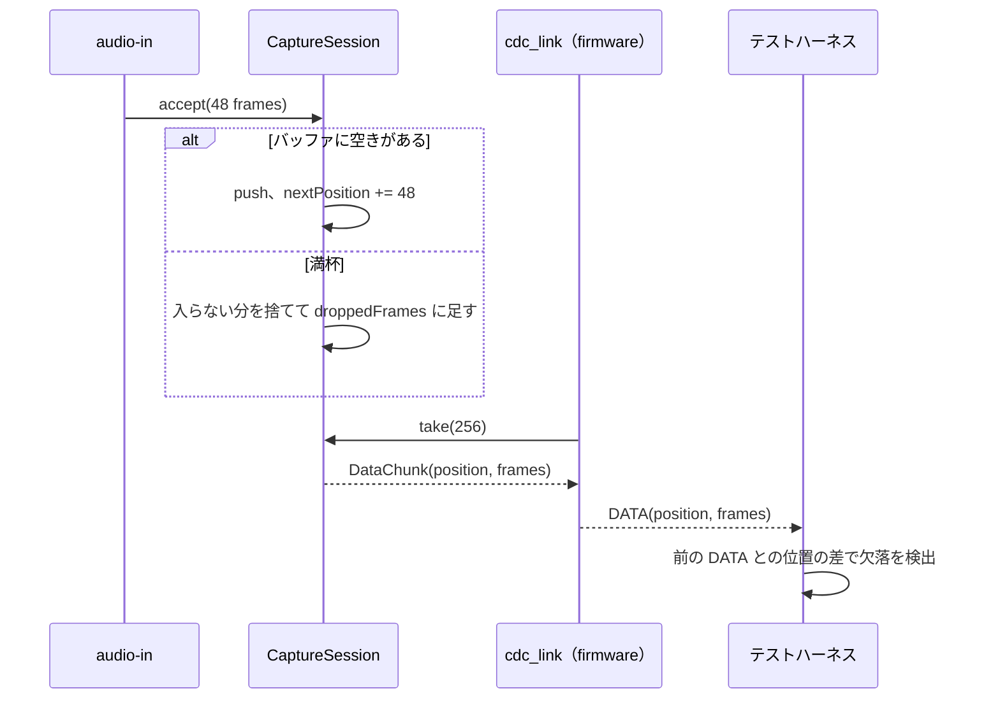
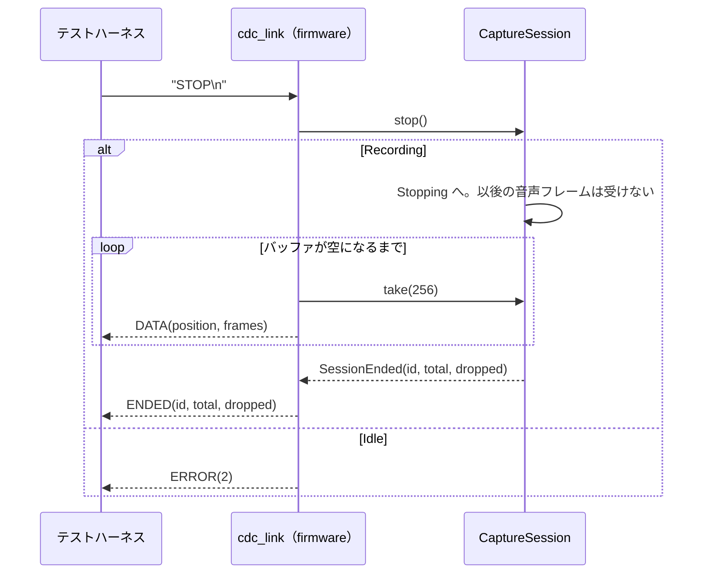
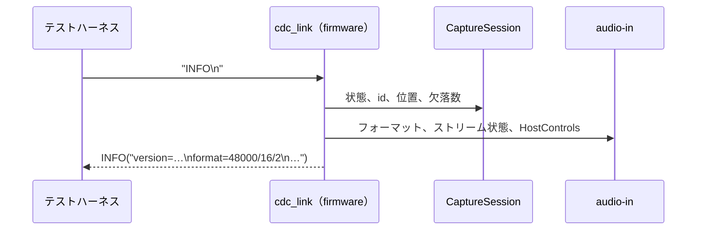

# capture-link — オブジェクトモデル

正本: [system-context.md](../../system-context.md)、[use-cases.md](../../use-cases.md)。

## この文脈が担うユースケース

| ID | ユースケース |
|---|---|
| CAP-1 | 録音セッションを開始する |
| CAP-2 | 録音データを受け取る |
| CAP-3 | 録音セッションを停止する |
| CAP-4 | デバイス情報を問い合わせる |

## やりとり

### CAP-1 録音セッションを開始する

### CAP-2 録音データを受け取る

### CAP-3 録音セッションを停止する

### CAP-4 デバイス情報を問い合わせる

INFO は録音中でも受け付ける。DATA の間に挟まって届く。

## Review Notes

### 2026-11-26 第 1 回

ユーザーがモデルを承認した。提示した判断点は既定案で確定した。

- ホスト側の途切れ（パケットが来ない区間）の検出は今回の範囲に含めない。USB フレーム番号（SOF）は DATA に載せない
- 録音中の START は ERROR(AlreadyRecording) を返し、進行中のセッションは続ける
- INFO（CAP-4）は残す
- ADR-0003、ADR-0004 は Accepted
