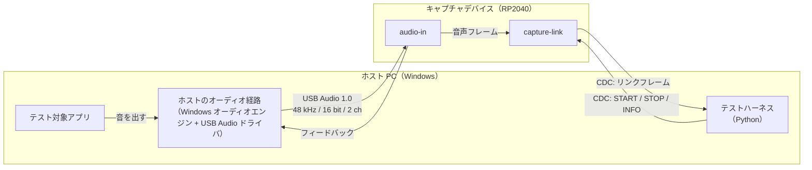

# システムコンテキスト

**リポジトリに 1 枚だけ。** 増分ごとに描き直さず、この図を更新する。

システムは **キャプチャデバイス**（RP2040 上の Rust ファーム）である。
接続する相手は 2 つあり、相手ごとに 1 つずつコンテキストを置く。

| コンテキスト | 相手 | 経路 | 詳細 |
|---|---|---|---|
| `audio-in` | ホストのオーディオ経路 | USB Audio 1.0（アイソクロナス OUT + フィードバック IN） | [context/audio-in/](context/audio-in/domain-model.md) |
| `capture-link` | テストハーネス | USB CDC ACM（バルク） | [context/capture-link/](context/capture-link/domain-model.md) |

テスト対象アプリはキャプチャデバイスと直接つながらない。
ホストのオーディオ経路を通してのみ影響するので、コンテキストを持たない。

## 境界の翻訳

`audio-in` は USB パケットを **音声フレーム** に翻訳して公開する。
`capture-link` は音声フレームだけを受け取り、USB Audio の語彙（代替設定、パケット、フィードバック）を知らない。
