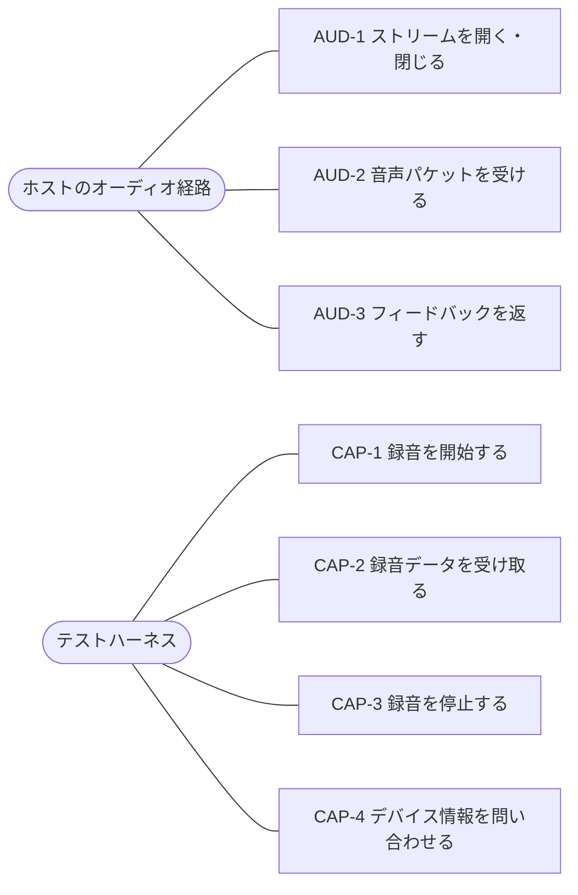

# ユースケース一覧

**リポジトリに 1 つだけ。** 各コンテキストの `object-model.md` は、自分の行だけを再掲する。
コンテキストは [system-context.md](system-context.md) を見よ。

| ID | ユースケース | アクター | コンテキスト | 追加した増分 |
|---|---|---|---|---|
| AUD-1 | 音声ストリームを開く・閉じる | ホストのオーディオ経路 | audio-in | usb-audio-capture |
| AUD-2 | 音声パケットを受け、音声フレームとして公開する | ホストのオーディオ経路 | audio-in | usb-audio-capture |
| AUD-3 | 送出レートのフィードバックを返す | ホストのオーディオ経路 | audio-in | usb-audio-capture |
| CAP-1 | 録音セッションを開始する | テストハーネス | capture-link | usb-audio-capture |
| CAP-2 | 録音データを受け取る | テストハーネス | capture-link | usb-audio-capture |
| CAP-3 | 録音セッションを停止する | テストハーネス | capture-link | usb-audio-capture |
| CAP-4 | デバイス情報を問い合わせる | テストハーネス | capture-link | usb-audio-capture |

